<!-- ═══════════════════════════ HEADER ═══════════════════════════ -->
<p align="center">
  
</p>

<p align="center">
  <a href="https://github.com/KalpeshEragi">
    
  </a>
</p>

<p align="center">
  <a href="https://www.linkedin.com/in/kalpesh-eragi-72562031a/"></a>
  <a href="mailto:kalpesheragi@gmail.com"></a>
  <a href="https://instagram.com/kalpesh_eragi"></a>
  
</p>

---

## 🧬 About Me

```python
class KalpeshEragi:
    role       = "AI/ML Engineer — building and evaluating LLM systems"
    education  = "B.Tech Computer Engineering (Honors in AI/ML) @ FCRIT · CGPA 9.42"
    focus      = ["Multi-Agent Systems", "Hybrid RAG", "LLM Evaluation", "Hallucination Detection"]
    recently   = {
        "eMerging Open Tech Foundation": "Project Intern — Decentra (Jul–Oct 2026)",
        "FCRIT":                          "Research Intern — Patently (Dec 2025–Mar 2026)",
        "Victor & Co.":                   "Web Dev Intern — B2B logistics site (Jan–Apr 2026)",
    }
    certified  = "Hugging Face Agents Course — Certificate of Excellence (Oct 2026)"
    principle  = "LLM proposes, code validates, a rule-based fallback keeps it correct."
    open_to    = ["AI/ML Internships", "Research collaborations", "Hackathons"]
```

---

## 🏆 Flagship · Decentra — a factory run by negotiating AI agents

<p align="center">
  <a href="https://github.com/KalpeshEragi/Decentralized-MRPII-System-Using-a-Negotiating-Multi-Agent-Architecture-"></a>
  
  
  
</p>

<p align="center">
  
</p>

> Six agents each own their data and negotiate delivery dates over **A2A** — no central orchestrator. **Zero double-bookings across 36 runs**, Kafka replaced by a **PostgreSQL outbox** (727 events, 0 failures), and it handles 4 disruptions a classic **MRP II** baseline can't replan.

<p align="center">
  
  
  
  
  
  
</p>

---

## 🚀 Featured Projects

<table>
<tr>
<td width="50%" valign="top">

### 🎓 [PlaceMates](https://github.com/KalpeshEragi/PlaceMates)
AI placement assistant for Indian freshers — finds jobs daily and emails tailored resumes for the top 3.

- LangGraph interview agent + hybrid ranking: **Precision@3 33% → 67%**
- 4-agent CrewAI pipeline: **−72% hallucinated claims**, **−50% tokens**

   

</td>
<td width="50%" valign="top">

### ⚖️ [Patently](https://github.com/KalpeshEragi/nlp-based-computational-analysis-of-patent-novelty)
Patent novelty analysis over **100K patents** with evidence-backed novelty & inventive-step reports.

- PatentSBERTa CPC classifier: **95.2%** top-5 on unseen patents
- Cross-encoder + SHAP leak fix: **87.2% recall** on rejected claims

  

</td>
</tr>
<tr>
<td width="50%" valign="top">

### 📑 [MetaPDF](https://github.com/KalpeshEragi/MetaPDF)
Evaluated hybrid RAG for PDF Q&A — BM25 + dense + RRF, cross-encoder reranking, page citations.

- Retrieval accuracy **71% → 94%**, input tokens **−74%**
- Local NLI detector: unsupported answers **50% → 20%**

  

</td>
<td width="50%" valign="top">

### 💰 [FinanceHub](https://github.com/KalpeshEragi/FinanceHub-A-Multi-Agent-AI-Platform-for-Personalised-Financial-Intelligence)
Multi-agent personal finance platform — bank-statement parsing, India tax engine and a "what-if" financial twin.

  

</td>
</tr>
</table>

<details>
<summary><b>➕ More builds</b></summary>
<br/>

- 🌿 [PublicSeva](https://github.com/KalpeshEragi/PublicSeva) — civic issue reporting with Gemini severity scoring
- 🏋️ [FITFUSION](https://github.com/KalpeshEragi/FITFUSIONN) — Android fitness app with an AI coach and offline-first sync
- 🚚 **Victor & Co.** — B2B logistics site + automated lead pipeline (Next.js, MongoDB, Vercel Cron)

</details>

---

## 📏 Measured Impact

<p align="center">
  
</p>

---

## 🧠 Skills

| Domain | Stack |
|:--|:--|
| **Agentic AI** |      |
| **RAG & Retrieval** |      |
| **LLM Evaluation** |  -FF8906?style=flat-square)   |
| **LLMs** |     |
| **ML / DL** |     |

<p align="center">
  
</p>

---

## 📊 GitHub Activity

<p align="center">
  
  
</p>

<p align="center">
  
</p>

<!-- Snake animation: generated daily by .github/workflows/snake.yml into the `output` branch -->
<p align="center">
  <picture>
    <source media="(prefers-color-scheme: dark)" srcset="https://raw.githubusercontent.com/KalpeshEragi/KalpeshEragi/output/github-contribution-grid-snake-dark.svg" />
    <source media="(prefers-color-scheme: light)" srcset="https://raw.githubusercontent.com/KalpeshEragi/KalpeshEragi/output/github-contribution-grid-snake.svg" />
    
  </picture>
</p>

---

<p align="center">
  
</p>


