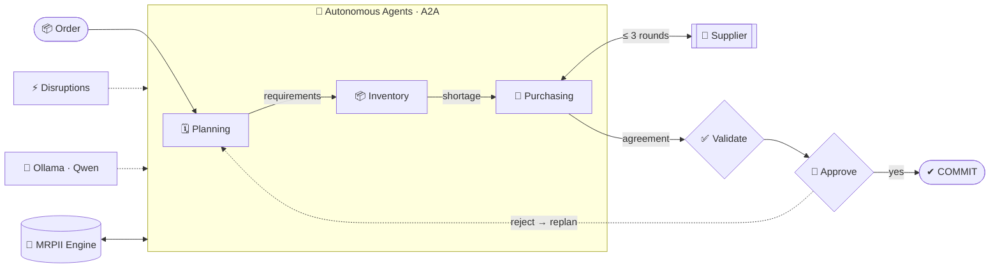
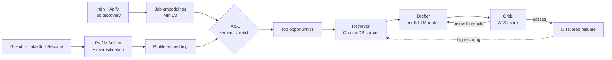

<!-- ═══════════════════════════ HEADER ═══════════════════════════ -->
<p align="center">
  
</p>

<p align="center">
  <a href="https://github.com/KalpeshEragi">
    
  </a>
</p>

<p align="center">
  <a href="https://www.linkedin.com/in/kalpesh-eragi-72562031a/"></a>
  <a href="mailto:kalpesheragi@gmail.com"></a>
  <a href="https://instagram.com/kalpesh_eragi"></a>
  
</p>

---

## 🧬 About Me

```python
class KalpeshEragi:
    role       = "AI Systems & Full-Stack Developer"
    focus      = ["Agentic AI", "Multi-Agent Systems", "RAG Pipelines", "Semantic Search"]
    building   = "Decentralized MRPII — LLM agents that negotiate a manufacturing plan"
    principle  = "Keep business truth deterministic. Let the LLM reason, never decide state."
    also_doing = "Shipping real features on the FCRIT Placement Cell site (legacy PHP)"
    open_to    = ["Internships", "Research collaborations", "Hackathons"]
```

---

## 📊 GitHub Stats

<p align="center">
  
  
</p>

---

## 🏆 Flagship Project

<h3 align="center">🏭 Decentralized MRPII — A Negotiating Multi-Agent Architecture</h3>

<p align="center">
  <a href="https://github.com/KalpeshEragi/Decentralized-MRPII-System-Using-a-Negotiating-Multi-Agent-Architecture-"></a>
  
  
  
</p>

> No central planner: **autonomous AI agents negotiate over A2A** to turn a customer order into a feasible manufacturing plan, and **re-negotiate** when disruptions hit.



<table>
<tr>
<td width="50%" valign="top">

**🧠 Key ideas**
- **No central decision-maker:** each agent owns its own goals and decisions
- **Multi-factor negotiation:** quantity, dates, lead time, priority
- **LLM advises, never decides:** outputs are validated deterministically
- **Bounded:** ≤ 3 rounds, ≤ 2 replans, human approval before `COMMIT`

</td>
<td width="50%" valign="top">

**⚡ What-if disruptions**
- 📦 1,000-unit SmartPhone X1 baseline order
- 🚚 Supplier delay · supplier qty 500 → 300
- 📈 Demand 1,000 → 1,300
- 🔒 Inventory reservation change
- ⏱️ Due date 30 → 20 days

</td>
</tr>
</table>

<p align="center">
  
  
  
  
  
  
</p>

---

## 🚀 Featured Projects

<table>
<tr>
<td width="50%" valign="top">

### 🎓 [PlaceMates](https://github.com/KalpeshEragi/PlaceMates)
AI placement platform that builds an **authentic** profile from your GitHub, LinkedIn and resume — then finds, ranks and applies to jobs.

- 🤖 **Multi-agent RAG** resume pipeline: Retriever → Drafter → Critic, iterative refinement
- 🔀 **Multi-LLM router** — Groq, Gemini, OpenAI, Cerebras, Together, Ollama with fallback
- 🔍 **Semantic job matching** — SentenceTransformers + FAISS + ChromaDB
- ⚙️ **n8n + Apify** automated job discovery → top-match selection
- 📊 Ablation & evaluation harness for RAG / critic / iteration

     

</td>
<td width="50%" valign="top">

### 💰 [FinanceHub](https://github.com/KalpeshEragi/FinanceHub-A-Multi-Agent-AI-Platform-for-Personalised-Financial-Intelligence)
AI-powered personal finance command center — track, budget, invest, plan taxes and simulate your financial future.

- 🪞 **Digital Financial Twin** — "what-if" future simulation
- 📄 **PDF bank-statement parsing** → categorized transactions
- 🧮 India tax engine (old vs new regime) + ITR form suggester
- 🧠 11 explainable AI services: budget agent, credit analysis, investment-readiness gate, smart alerts
- 🔐 JWT + HTTP-only cookies, dark mode, 57 Radix UI primitives

    

</td>
</tr>
<tr>
<td width="50%" valign="top">

### ⚖️ [Patent Novelty Analyzer](https://github.com/KalpeshEragi/nlp-based-computational-analysis-of-patent-novelty)
NLP inference engine that quantitatively judges whether a patent claim is **inventive** against prior art.

- 🧩 spaCy claim parsing into components (nouns) & functions (verbs)
- 📐 MiniLM embeddings + cosine Top-K prior-art ranking
- ⚖️ Rule-based verdicts: `INVENTIVE` / `WEAK INVENTIVE` / `NOT INVENTIVE`
- 🕸️ Bipartite knowledge graphs (NetworkX) + Gemini legal summaries

   

</td>
<td width="50%" valign="top">

### 📑 [MetaPDF](https://github.com/KalpeshEragi/MetaPDF)
AI document assistant — chat with PDFs, summarize them, and convert Office files to PDF.

- 💬 **RAG chat** over PDFs — LangChain + FAISS + Gemini
- 📝 Abstractive summaries with **BART-large-CNN** (beam search, chunked)
- 🔄 DOCX / PPT / Excel / TXT → PDF converters
- ⚡ GPU-accelerated with PyTorch + CUDA

    

</td>
</tr>
<tr>
<td width="50%" valign="top">

### 🌿 [PublicSeva](https://github.com/KalpeshEragi/PublicSeva)
Civic issue reporting platform with **Gemini AI severity scoring**, interactive maps and real-time issue tracking.

  

</td>
<td width="50%" valign="top">

### 🏋️ [FITFUSION](https://github.com/KalpeshEragi/FITFUSIONN)
Android fitness app — Gemini AI coach, ML nutrition/TDEE predictor, nearby-gym finder (OSM + Overpass), offline-first sync.

   

</td>
</tr>
</table>

<details>
<summary><b>🔬 Peek inside PlaceMates' AI pipeline</b></summary>
<br/>



</details>

---

## 🧠 Skills — Organized by Domain

### 🤖 Artificial Intelligence

| Domain | Stack |
|:--|:--|
| **Agentic AI** |      |
| **RAG & Vector Search** |     |
| **LLMs & Providers** |       |
| **Deep Learning & NLP** |     |
| **Machine Learning & Data** |      |

### 🛠️ Engineering

<table>
<tr><td><b>💻 Languages</b></td><td></td></tr>
<tr><td><b>🎨 Frontend</b></td><td></td></tr>
<tr><td><b>⚙️ Backend & APIs</b></td><td></td></tr>
<tr><td><b>🗄️ Databases</b></td><td></td></tr>
<tr><td><b>📱 Mobile</b></td><td> &nbsp;  </td></tr>
<tr><td><b>🚢 DevOps & Tools</b></td><td> &nbsp;  </td></tr>
<tr><td><b>🔐 Auth & Security</b></td><td>   </td></tr>
</table>

---

## 💻 Languages & Contributions

<p align="center">
  
</p>

<!-- Snake animation: generated daily by .github/workflows/snake.yml into the `output` branch -->
<p align="center">
  <picture>
    <source media="(prefers-color-scheme: dark)" srcset="https://raw.githubusercontent.com/KalpeshEragi/KalpeshEragi/output/github-contribution-grid-snake-dark.svg" />
    <source media="(prefers-color-scheme: light)" srcset="https://raw.githubusercontent.com/KalpeshEragi/KalpeshEragi/output/github-contribution-grid-snake.svg" />
    
  </picture>
</p>

---

<p align="center">
  <i>"Let the agents negotiate. Keep the math deterministic."</i>
</p>


